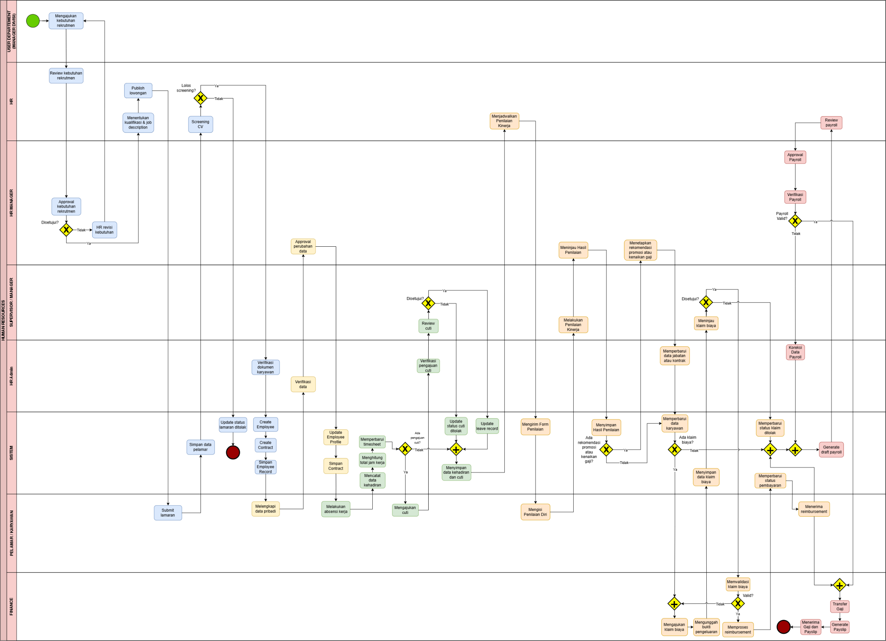

# HRM Business Process Modeling

## Overview

This directory contains the Business Process Model and Notation (BPMN) diagram developed for the Human Resource Management (HRM) processes of MAKO Cake and Bakery.

The diagram illustrates the business workflow, activities, decision points, and responsibilities involved in managing human resources.

## Process Coverage

The BPMN model represents the following business activities:

- Recruitment planning and approval.
- Candidate screening and interview.
- Employee onboarding and contract management.
- Employee data administration.
- Attendance and time-off management.
- Performance evaluation.
- Employee expense claims and reimbursement.
- Payroll validation, approval, and payment.

## HRM BPMN Diagram

*Figure 1. HRM Business Process Model – MAKO Cake and Bakery*

## Individual Contribution

The HRM process modeling documented in this repository represents my individual contribution to the MAKO Cake and Bakery group ERP project.

The diagram was developed to visualize business workflows and the relationships between employees, HR personnel, managers, and system activities.
