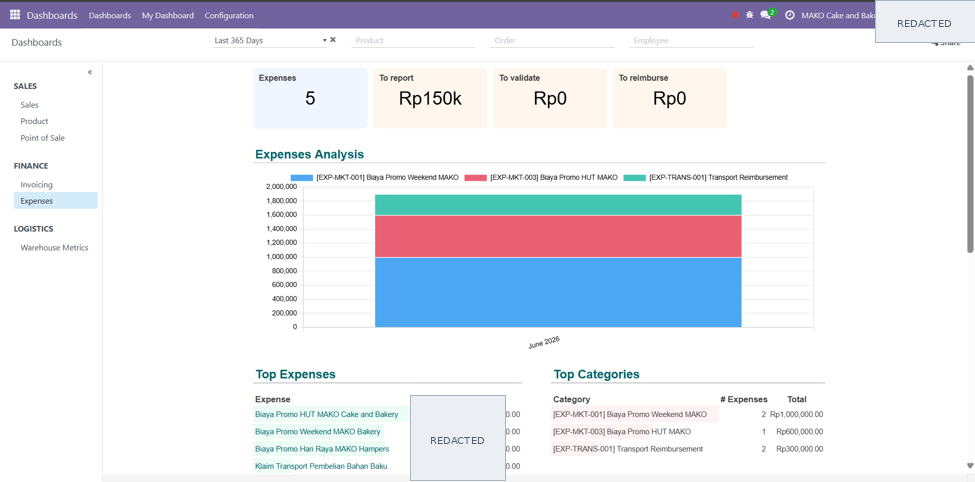
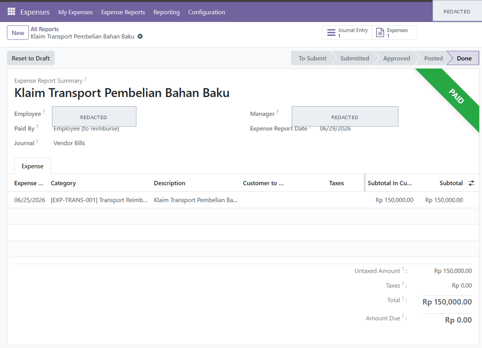
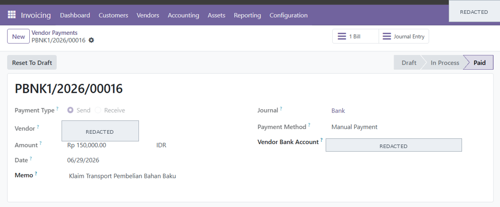

# Expenses Management – Odoo 18

## Overview

This directory contains selected screenshots documenting my individual implementation of the Expenses module for MAKO Cake and Bakery using Odoo 18.

The implementation focuses on recording employee operational expenses, managing reimbursement claims, and monitoring expense transactions through the Odoo dashboard.

The process demonstrates how employees can submit expenses incurred for company activities and receive reimbursement through the system.

These screenshots provide visual evidence of the Expenses implementation activities described in my individual project report.

## Implementation Scope

The Expenses implementation covers the following activities:

| Implementation Area | Description |
|---|---|
| Expenses Dashboard | Monitoring expense summaries and transaction status |
| Employee Expense Claims | Recording employee operational expense claims |
| Expense Category | Using the Transport Reimbursement category |
| Payment Method | Configuring Employee to Reimburse |
| Reimbursement Processing | Processing employee expense reimbursement |
| Payment Status | Verifying completed reimbursement transactions |

## Expenses Implementation Screenshots

### 1. Expenses Dashboard

Reviewed the Odoo Expenses dashboard to monitor employee expense records, transaction summaries, and reimbursement status.

The dashboard provides information about total expenses, expense analysis, and employee expense activities.

*Figure 1. Expenses dashboard and transaction overview.*

### 2. Employee Expense Claim

Created an employee expense claim for purchasing-related transportation.

The expense was recorded with the following details:

| Expense Information | Details |
|---|---|
| Employee Role | Purchasing Staff |
| Expense Category | Transport Reimbursement |
| Expense Amount | Rp150,000 |
| Paid By | Employee to Reimburse |
| Purpose | Purchasing-related transportation |

The Employee to Reimburse method indicates that the employee initially paid for the operational expense and the company was responsible for reimbursing the amount.

*Figure 2. Employee transportation expense claim.*

### 3. Reimbursement Processing

Processed the recorded expense claim through the reimbursement workflow.

The transaction was recorded through the Odoo payment process using the Bank journal.

The Paid status indicates that the reimbursement transaction had been completed.

*Figure 3. Completed employee reimbursement payment.*

## Dashboard Monitoring & Evaluation

The Expenses dashboard was also used to review employee expense summaries and reimbursement information.

The individual implementation report documented the following observations:

- The To Validate amount was Rp0 after processing.
- The To Reimburse amount was Rp0 after reimbursement was completed.
- The Top Employees section provided information about employee expense totals.
- The Top Reinvoiced Orders section did not display data because the recorded expenses represented internal company costs and were not reinvoiced to customers.

These dashboard features support the monitoring and evaluation of employee expense activities.

## Implementation Summary

The Expenses implementation demonstrated the following process:

1. Recording employee operational expenses.
2. Selecting the appropriate expense category.
3. Defining the employee reimbursement payment method.
4. Processing the expense claim.
5. Recording the reimbursement payment.
6. Monitoring the completed transaction through the dashboard.

## Individual Contribution

The Expenses implementation documented in this directory represents my individual contribution to the MAKO Cake and Bakery group ERP project.

My responsibilities focused on creating employee expense claims, managing reimbursement transactions, reviewing expense dashboards, and documenting the implementation results.

For additional details, see the [Individual Contribution Report](../../docs/individual-contribution.md).

---

*Academic Group Project | Universitas Esa Unggul | 2026*
