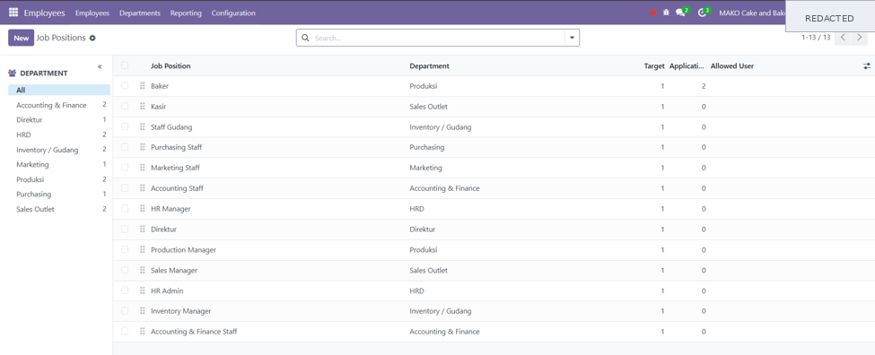
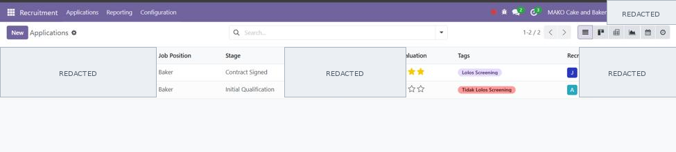
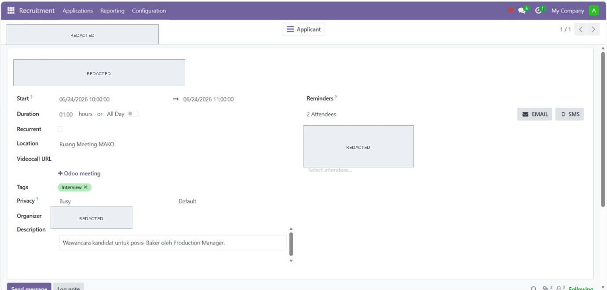
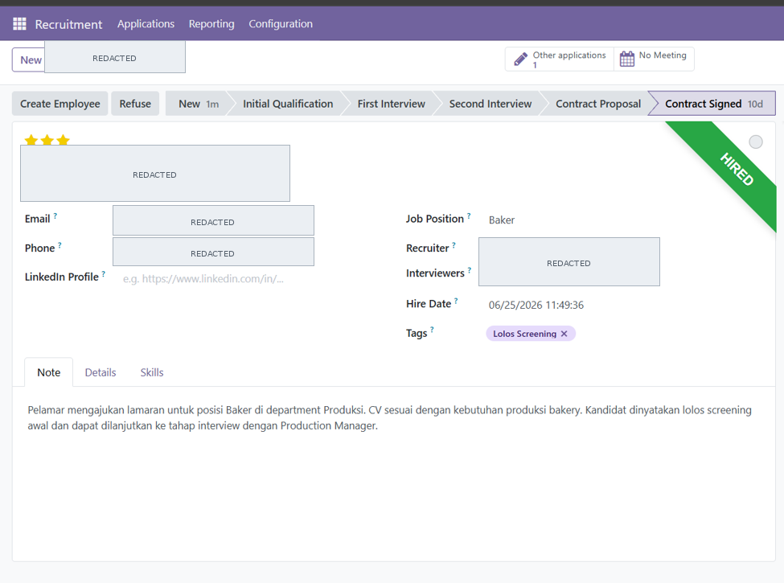
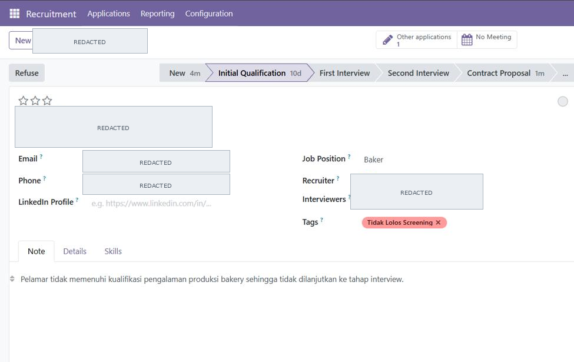
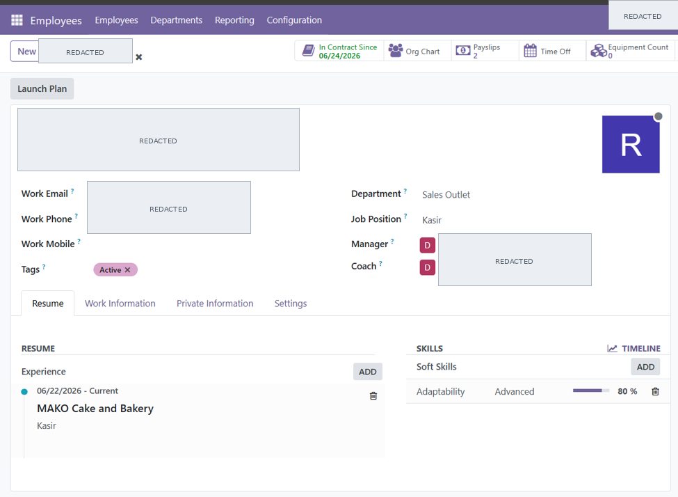
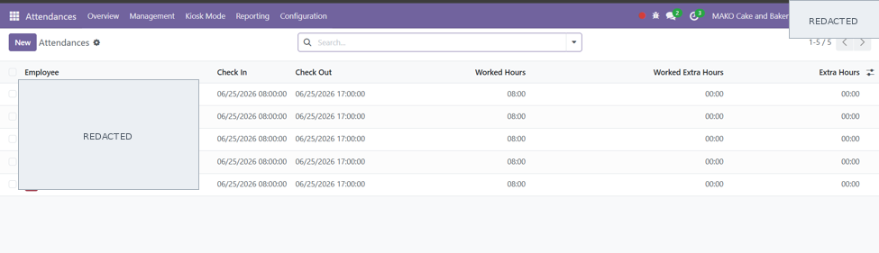
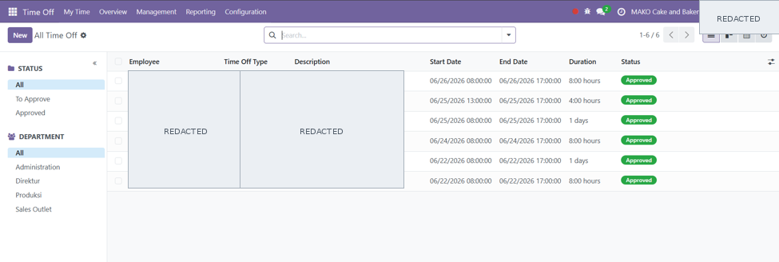
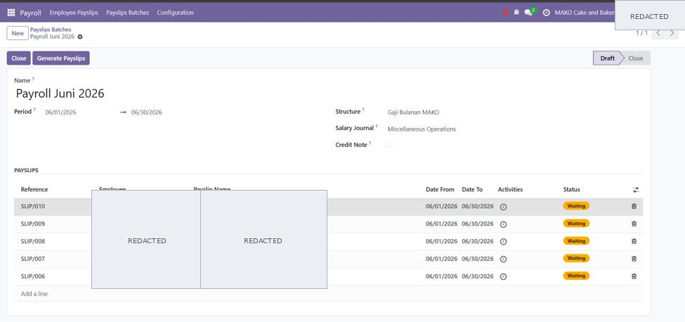
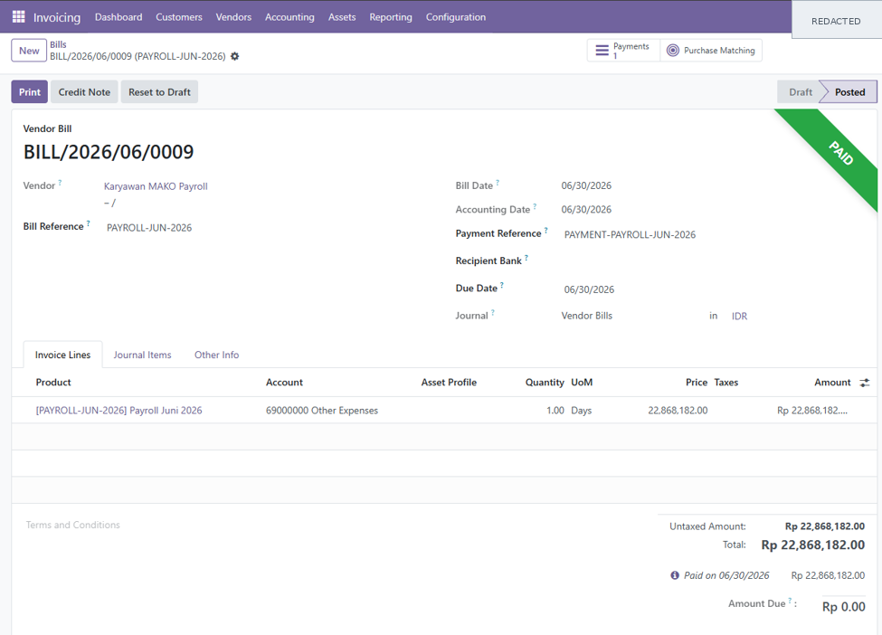

# Human Resource Management (HRM) – Odoo 18

## Overview

This directory contains selected screenshots documenting my individual implementation of the Human Resource Management (HRM) processes for MAKO Cake and Bakery using Odoo 18.

The implementation focuses on managing employee information and supporting the employee lifecycle, starting from job position configuration and recruitment to employee administration, attendance, time-off management, and payroll processing.

These screenshots provide visual evidence of the HRM implementation activities described in my individual project report.

## Implementation Scope

The HRM implementation covers the following activities:

| Implementation Area | Description |
|---|---|
| Job Position | Configuring job positions and department assignments |
| Recruitment | Managing applicant records and recruitment stages |
| Interview Scheduling | Scheduling candidate interviews |
| Candidate Selection | Recording accepted and rejected applicants |
| Employee Management | Creating and maintaining employee records |
| Attendance | Recording employee check-in and check-out activities |
| Time Off | Managing employee leave requests and approval status |
| Payroll | Preparing payroll batches and recording payroll transactions |

## HRM Implementation Screenshots

### 1. Job Position Configuration

Configured job positions and department assignments to represent the organizational structure of MAKO Cake and Bakery.

*Figure 1. Job positions configured in Odoo 18.*

### 2. Recruitment Applications

Created recruitment records for the Baker position and managed applicant information through the recruitment process.

*Figure 2. Recruitment applications and selection stages.*

### 3. Interview Scheduling

Scheduled a candidate interview through the Odoo meeting feature, connecting recruitment activities with the interview process.

*Figure 3. Candidate interview scheduling.*

### 4. Accepted Candidate

Recorded an applicant who successfully passed the recruitment process and progressed to the hiring stage.

*Figure 4. Applicant who passed the selection process.*

### 5. Rejected Candidate

Recorded an applicant who did not meet the recruitment requirements and was marked as rejected.

*Figure 5. Applicant recorded as not selected.*

### 6. Employee Profile Management

Created and maintained employee master data across business departments. The implementation included 12 active employee records.

*Figure 6. Employee profile and administrative information.*

### 7. Attendance Records

Used the Attendances module to record employee check-in and check-out activities and monitor working hours.

*Figure 7. Employee attendance records.*

### 8. Time Off Management

Recorded employee leave requests, including Unpaid Leave and Sick Time Off, with approved status.

*Figure 8. Employee time-off records and approval status.*

### 9. Payroll Batch Processing

Prepared a June 2026 payroll batch for five employees using OCA Payroll.

| Payroll Description | Amount |
|---|---:|
| Gross Payroll | Rp23,300,000 |
| Unpaid Leave Deductions | Rp431,818 |
| **Final Payroll** | **Rp22,868,182** |

*Figure 9. June 2026 payroll batch.*

### 10. Payroll Recording and Payment

Recorded the final payroll through Vendor Bill in the Odoo Invoicing module and documented the completed payment status.

*Figure 10. Posted and paid payroll Vendor Bill.*

## Implementation Notes & Limitations

- **Performance Evaluation:** The Appraisals module was unavailable in the Odoo environment. Performance evaluation activities were therefore documented using Activity and Log Note in the Employees module.
- **Payroll Processing:** The OCA Payroll confirmation workflow could not be completed because the Salary Journal configuration was not fully available. Final payroll recording and payment were handled through Vendor Bill and Vendor Payment.
- **Project Environment:** All employee records and payroll transactions represent simulated data used for academic implementation purposes.

## Individual Contribution

The HRM implementation documented in this directory represents my individual contribution to the MAKO Cake and Bakery group ERP project.

My responsibilities focused on employee administration, recruitment, attendance, time-off management, payroll processing, and related HRM documentation.

For additional details, see the [Individual Contribution Report](../../docs/individual-contribution.md).

---

*Academic Group Project | Universitas Esa Unggul | 2026*
